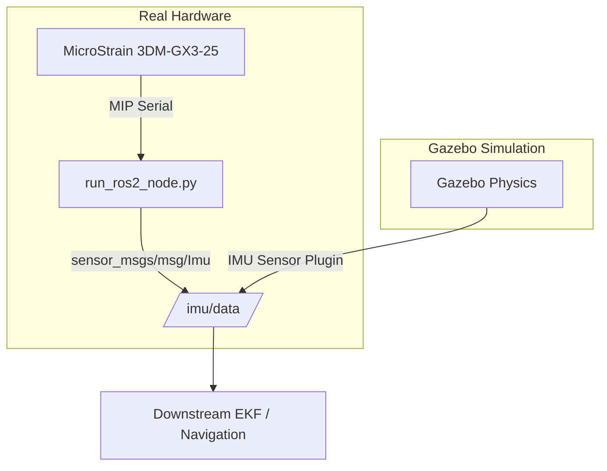

# LORD MicroStrain 3DM-GX3-25: ROS 2 Humble and Gazebo Integration

Integration details for running the standalone ROS 2 Humble node and matching Gazebo simulation plugins.

---

## 1. Interface Architecture

Both physical hardware and simulation publish to identical ROS 2 Humble topics:

* `/imu/data`: `sensor_msgs/msg/Imu` (orientation quaternion, angular velocity, linear acceleration).
* `/imu/mag`: `sensor_msgs/msg/MagneticField` (3-axis magnetometer vector).
* Frame ID: `imu_link`.



---

## 2. Running the ROS 2 Humble Node

Execute the standalone node directly with Python (no launch files required):

```bash
# Run with default settings (auto-detected port, 50 Hz, frame: imu_link)
python utils/microstrain_3dmgx3_25/code/run_ros2_node.py

# Run with custom parameters
python utils/microstrain_3dmgx3_25/code/run_ros2_node.py --port COM4 --rate 100 --frame-id imu_link
```

Parameters:
* `--port <str>`: Serial port name (default: auto-detected).
* `--rate <int>`: Publishing frequency in Hz (default: 50).
* `--frame-id <str>`: Header frame ID (default: `imu_link`).
* `--no-mag`: Disable `/imu/mag` publishing.

Verify published topics in a separate shell:
```bash
ros2 topic echo /imu/data
ros2 topic hz /imu/data
```

---

## 3. Gazebo Simulation Configurations

### Option A: Gazebo Classic (Gazebo 11 on ROS 2 Humble)
Add this URDF / Xacro macro to your robot model:

```xml
<!-- Physical link for 3DM-GX3-25 -->
<link name="imu_link">
  <inertial>
    <!-- Mass: 18 grams -->
    <mass value="0.018"/>
    <origin xyz="0 0 0" rpy="0 0 0"/>
    <inertia ixx="1e-5" ixy="0" ixz="0" iyy="1e-5" iyz="0" izz="1e-5"/>
  </inertial>
  <visual>
    <origin xyz="0 0 0" rpy="0 0 0"/>
    <geometry>
      <!-- Physical dimensions: 44 x 24 x 11 mm -->
      <box size="0.044 0.024 0.011"/>
    </geometry>
    <material name="aluminum_blue">
      <color rgba="0.1 0.25 0.4 1.0"/>
    </material>
  </visual>
</link>

<!-- Gazebo Classic sensor plugin -->
<gazebo reference="imu_link">
  <gravity>true</gravity>
  <sensor name="imu_sensor" type="imu">
    <always_on>true</always_on>
    <update_rate>50.0</update_rate>
    <visualize>true</visualize>
    <topic>/imu/data</topic>
    <plugin filename="libgazebo_ros_imu_sensor.so" name="imu_plugin">
      <ros>
        <namespace>/</namespace>
        <remapping>~/out:=/imu/data</remapping>
      </ros>
      <initial_orientation_as_reference>false</initial_orientation_as_reference>
    </plugin>
  </sensor>
</gazebo>
```

### Option B: Modern Gazebo (Gazebo Fortress / Harmonic)
Add this sensor definition inside your SDF file:

```xml
<link name="imu_link">
  <sensor name="imu_sensor" type="imu">
    <always_on>1</always_on>
    <update_rate>50</update_rate>
    <visualize>true</visualize>
    <topic>imu</topic>
    <imu>
      <angular_velocity>
        <x>
          <noise type="gaussian">
            <mean>0.0</mean>
            <!-- Gyro noise density: 0.03 deg/s/sqrt(Hz) -->
            <stddev>0.00052</stddev>
          </noise>
        </x>
        <y><noise type="gaussian"><stddev>0.00052</stddev></noise></y>
        <z><noise type="gaussian"><stddev>0.00052</stddev></noise></y>
      </angular_velocity>
      <linear_acceleration>
        <x>
          <noise type="gaussian">
            <mean>0.0</mean>
            <!-- Accel noise density: 80 ug/sqrt(Hz) -->
            <stddev>0.00784</stddev>
          </noise>
        </x>
        <y><noise type="gaussian"><stddev>0.00784</stddev></noise></y>
        <z><noise type="gaussian"><stddev>0.00784</stddev></noise></y>
      </linear_acceleration>
    </imu>
  </sensor>
</link>
```

Bridge the Gazebo topic to ROS 2 Humble using `ros_gz_bridge`:
```bash
ros2 run ros_gz_bridge parameter_bridge /imu@sensor_msgs/msg/Imu[gz.msgs.IMU --ros-args -r /imu:=/imu/data
```

---

## 4. Sensor Noise Parameters (3DM-GX3-25)

Simulation tuning metrics based on factory specifications:

| Metric | Accelerometer | Gyroscope |
|---|---|---|
| Measurement Range | $\pm 5\text{ g}$ | $\pm 300^\circ/\text{s}$ |
| Noise Density | $80\ \mu\text{g}/\sqrt{\text{Hz}}$ | $0.03^\circ/\text{s}/\sqrt{\text{Hz}}$ ($5.2\times 10^{-4}\text{ rad/s}/\sqrt{\text{Hz}}$) |
| Standard Deviation (at 50 Hz) | $0.0056\text{ g}$ ($0.055\text{ m/s}^2$) | $0.21^\circ/\text{s}$ ($0.0037\text{ rad/s}$) |
| Static Attitude Accuracy | $\pm 0.5^\circ$ | N/A |
| Dynamic Attitude Accuracy | $\pm 2.0^\circ$ | N/A |
